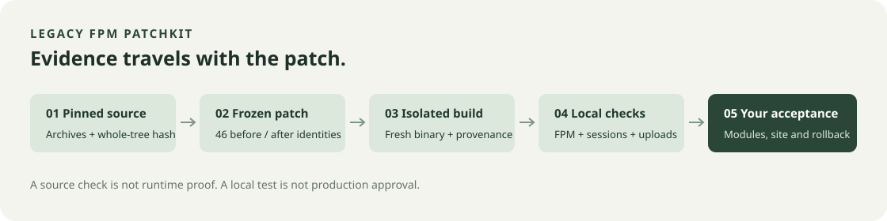

# Legacy FPM Patchkit

**PHP 7.0 FPM을 즉시 업그레이드하기 어려운 운영자를 위한 소스·빌드·검증 도구입니다.**

원본을 재구성하고, 패치를 확인하고, 격리 환경에서 빌드한 뒤 자신의 환경에서 검증합니다.

[English](README.md) · [시작하기](docs/GETTING_STARTED.ko.md) · [지원 범위](SUPPORT.md) · [검증 기록](docs/VERIFICATION.md) · [전체 문서](docs/README.md)

소스 릴리스에는 SHA-256 체크섬과 GitHub 출처 증명이 포함됩니다. [다운로드 검증 방법](docs/RELEASE_NOTES.md)을 확인하세요.

> **지원이 종료된 런타임을 위한 소스 배포판입니다.** Ubuntu `7.0.33-0ubuntu0.16.04.16` 소스에 특정 보안 변경을 이식합니다. PHP 7.0 전체의 보안 지원을 복구하거나 모든 확장 모듈·사이트의 호환성을 보장하지 않습니다. 가능하면 공식 지원 중인 PHP로 이전하세요.

<!-- SECURITY_COVERAGE_START -->
## 공식 취약점 대응 현황 — 2026-11-14

공식 PHP 저장소의 공개 공지 **66건 전체**를 고정 소스와 대조했습니다. 범위와 항목별 근거·예정 작업은 [전체 대응표](docs/SECURITY_COVERAGE.ko.md)에서 확인하세요.

| 공식 목록 내 상태 | 건수 |
|---|---|
| 해결됨 · 수정 구현 | 2 |
| 영향 없음 · 해당 결함 경로 부재 | 14 |
| 미해결 · 검토·구현 예정 | 50 |

기존 Ubuntu vendor 패치로 포함된 **CVE 31건은 별도 집계**합니다. 해결됨은 수정 코드가 존재한다는 뜻이며 모든 공격 차단을 실증했다는 뜻은 아닙니다. 미구현 보호는 통과로 표시하지 않습니다. 이 대응표는 현재 공식 GitHub 목록과 명시한 vendor 패치를 대상으로 하며 모든 시대의 PHP·의존 라이브러리 CVE 전체를 뜻하지 않습니다.

기존 51건을 [실제 구현 필요성](docs/IMPLEMENTATION_NECESSITY.ko.md)부터 재검토했습니다. 공개 Xenial FPM 기준 **수정 필요 22 / 조건부 23 / 다른 OS·SAPI 5 / 해당 경로 없음 1건**입니다. 먼저 해당 조건을 확인하고 필요한 보호만 구현합니다.
<!-- SECURITY_COVERAGE_END -->

## 실제 Linux에서 확인한 추가 수정 두 건

명시적으로 선택하는 **`acl-filter-20261114`** 소스 변형에 다음 두 보호를 추가했습니다.

| 공식 공지 | 원인과 수정 | 실제 관측 |
|---|---|---|
| [CVE-2026-91768 / GHSA-62xp-839h-2637](https://github.com/php/php-src/security/advisories/GHSA-62xp-839h-2637) | FPM이 IPv6 주소 16바이트 중 12바이트만 비교했습니다. 전체 주소를 비교하도록 고치고 mapped IPv4의 오프셋12·비교길이4는 유지했습니다. | 기준선에서 허용되던 다른 IPv6 주소가 후보에서 거부됐습니다. 정확 일치와 IPv4·mapped 정상 동작도 유지됐습니다. |
| [GHSA-ch8v-r6jh-4vvr](https://github.com/php/php-src/security/advisories/GHSA-ch8v-r6jh-4vvr) — CVE 번호 없음 | URL 인코딩 표 256칸 중 255칸만 초기화했습니다. 모든 칸을 초기화하도록 고쳤습니다. | 기준선에서 Valgrind 미초기화 읽기37회, 후보 오류0건을 확인했습니다. 필터 출력270건과 PHPT 정상 대조도 통과했습니다. |

[실제 Linux CI](https://github.com/Two-Weeks-Team/legacy-fpm-patchkit/actions/runs/43592653493), [해시를 포함한 결과](evidence/acl-filter-portable-20261114.json), [빌드·검증 방법](docs/ACL_FILTER_VARIANT.md)을 공개합니다. 검증 환경은 Ubuntu22.04 portable CLI/FPM입니다. Xenial ABI·외부 모듈·운영 배포는 별도 검증 대상입니다.

위 대응표는 보존된 기본 **build007** 소스 기준입니다. 이 변형을 선택하면 두 구현이 추가되어 같은 공식66건에서 **구현4 / 해당 경로 부재14 / 예정48건**이 됩니다. 준비 명령은 `python3 -m patchkit prepare --variant acl-filter-20261114 --output .work/source-candidate`입니다. 기본 명령과 v0.1.0 다운로드는 build007을 유지합니다.

공식 공지는 [Cloudflare Workers 매시간 예약·로컬 배치](docs/ADVISORY_AUTOMATION.ko.md)로 자동 수집할 수 있습니다. 새 공지와 변경 항목은 별도 구현 작업 목록으로 제공됩니다.

## 실제 FPM에서 확인한 multipart 보호 두 건

누적 변형 **`multipart-20261114`**는 앞의 ACL·필터 수정을 포함하고 다음 두 보호를 더합니다.

| 공식 문제 | 원인과 수정 | 실제 관측 |
|---|---|---|
| [CVE-2024-8925 / GHSA-9pqp-7h25-4f32](https://github.com/php/php-src/security/advisories/GHSA-9pqp-7h25-4f32) | multipart 경계 문자열이 고정 읽기 버퍼의 처리 범위를 넘을 수 있었습니다. 버퍼 할당 전에 5116바이트 상한을 검사합니다. | 양쪽 모두 5115·5116바이트를 정상 처리하고, 수정본만 5117바이트를 거부했습니다. 거부된 요청의 필드·파일은 등록되지 않았습니다. |
| [CVE-2023-0662 / GHSA-54hq-v5wp-fqgv](https://github.com/php/php-src/security/advisories/GHSA-54hq-v5wp-fqgv) | 변수·파일 각각의 제한만으로 전체 part 수를 제한하지 못했습니다. 요청마다 초기화하는 총량 제한과 안전한 기본 합산을 추가했습니다. | 작은 한도 3에서 부모는 4개를 처리하고 수정본은 3개 뒤 멈췄으며 요청마다 경고는 정확히 한 번입니다. 정상 입력·기존 제한·동일 worker의 반복 요청은 유지됐습니다. |

[최종 Linux CI](https://github.com/Two-Weeks-Team/legacy-fpm-patchkit/actions/runs/43599570950)에서 FPM 요청60개, 양쪽 각각 INI PHPT2개와 정상 점검36개를 확인했습니다. 앞선 완전한 실행과도 결과가 같으며, 최초 시험 fixture의 실패는 보존했습니다. [결과와 보존 원자료](evidence/multipart-portable-20261114.json), [준비 명령·동작 변화·한계](docs/MULTIPART_VARIANT.md)를 공개합니다.

선택 명령은 `python3 -m patchkit prepare --variant multipart-20261114 --output .work/source-multipart`입니다. 이 누적 변형은 공식66건 중 **구현6 / 해당 경로 부재14 / 예정46건**, 기본 build007은 **2 / 14 / 50**입니다. Ubuntu22.04 portable에서 확인한 결과이며 Xenial·외부 모듈·실제 사이트·운영 배포 승인을 뜻하지 않습니다. core globals 구조가 바뀌므로 새 빌드가 필요합니다.

## 실제 CLI/FPM에서 확인한 쿠키 접두사 보호

누적 변형 **`cookie-20261114`**는 [CVE-2024-2756 / GHSA-wpj3-hf5j-x4v4](https://github.com/php/php-src/security/advisories/GHSA-wpj3-hf5j-x4v4)를 추가로 보완합니다. PHP가 입력 이름을 정규화하면서 다른 이름을 `__Host-`·`__Secure-` 접두사로 바꿀 수 있어, 보호 이름의 쿠키로 오인될 수 있었습니다. 원래 등록 이름을 별도로 보존하고 실제 대입 키를 검사해, 짝 없는 대괄호의 평문 처리·배열·중첩 키까지 막습니다. 같은 등록 함수를 쓰는 GET/POST에도 적용됩니다.

[실제 Linux 실행](https://github.com/Two-Weeks-Team/legacy-fpm-patchkit/actions/runs/43603792774)에서 **CLI는 양쪽 각각19개 사례, FPM은 총76개 요청**을 검증했고, 독립 모델도 Cookie/GET/POST의 키 타입·값과 일치했습니다. 수정본만 만들어진 보호 접두사를 거부하며, 정당한 이름·일반 배열·중복 처리·이진 값은 유지됩니다. PHPT1개는 부모에서 기대대로 실패하고 수정본에서 통과했으며, 양쪽 각각 정상 점검36개도 통과했습니다. 첫 fixture 기록 도구의 실패는 보존했습니다. [결과와 보존 원자료](evidence/cookie-portable-20261114.json), [동작·명령·한계](docs/COOKIE_VARIANT.md)를 공개합니다.

선택 명령은 `python3 -m patchkit prepare --variant cookie-20261114 --output .work/source-cookie`입니다. 누적 현황은 **구현7 / 해당 경로 부재14 / 예정45건**, 기본 build007은 **2 / 14 / 50**입니다. portable Linux의 이름 등록 검증이며, 인증·TLS·쿠키 보안 속성·Xenial·외부 모듈·실제 사이트 호환성·운영 배포는 별도입니다.

## 구형 FPM 로그의 데이터 소실도 보완했습니다

누적 변형 **`fpm-log-20261114`**는 worker의 stdout/stderr에 NUL이 들어오면 같은 읽기 묶음의 나머지와 후속 정상 줄까지 사라지던 문제를 보완합니다. 바이트 길이로 처리하고 제어문자·역슬래시를 명시적으로 표현하며 기록 크기를 제한합니다. 짧은 일반 인쇄 가능 문자는 유지됩니다. [표현 변화와 준비 명령](docs/FPM_LOG_VARIANT.md)을 정리했습니다.

[실제 Linux 실행](https://github.com/Two-Weeks-Team/legacy-fpm-patchkit/actions/runs/43606021097)에서 출력 요청48개와 별도 확인 요청48개를 완료했습니다. 독립 검사가 master 로그328개 기록과 일치했고 FPM24개가 정상 종료했습니다. 양쪽 각각 출력 도구 PHPT와 정상 점검36개도 통과했습니다. [결과·원자료](evidence/fpm-log-portable-20261114.json)에 후보에서만 JSON 스캐너가 재생성된 사실도 보존하므로 컴파일 입력이 모두 같았다고 주장하지 않습니다. 파일 로그 보완의 근거이며 syslog 전송이나 CVE 전체 해결은 아니어서 누적 집계는 **7 / 14 / 45**입니다.

## JSON 빌드 입력도 내용으로 확인합니다

같은 준비 소스에서도 복사 시각에 따라 JSON 코드가 다시 생성될 수 있던 경로를 보완했습니다. 입력·생성 C·헤더6개를 고정 해시로 확인하고 빌드 전후 기록을 결부합니다. [실제 Linux 검증](docs/BUILDING.md)에서 세 빌드 모두 JSON 재생성0건, 단위 시험131개와 새 바이너리의 FPM 로그 동작 보존을 확인했습니다. [결과·원자료](evidence/json-generation-portable-20261115.json)는 기존 실행을 보존하며 바이너리 직접 해시 검증과 기록 간 식별명 일치를 구분합니다. 검증 대상은 JSON 입력이며 전체 바이너리의 바이트 단위 재현성은 별도 속성입니다.

## 어떤 문제가 있었고, 무엇을 고쳤나요?

**기본 build007은 공개된 PHP 엔진 취약점 두 종류와, 이를 PHP 7.0 FPM에 이식할 때 필요한 요청·세션 경계 보호를 함께 수정합니다.** 위 선택 변형은 별도로 검증한 보호를 추가합니다. 해당 소스 변경과 동일성 검증을 제공하며, 아래 정상 기능 시험도 완료했습니다. 이를 두 엔진 CVE의 모든 공격이 PHP 7.0에서 차단됐다는 실증으로 확대하지는 않습니다.

| 공개된 문제 | 원인과 영향 | 이 패치의 해결 방법 |
|---|---|---|
| **[CVE-2026-109618 — 메모리 부족 시 내부 상태 손상](https://github.com/php/php-src/security/advisories/GHSA-w8hw-w9fx-j79w)** | 메모리 부족(OOM)으로 처리를 갑자기 벗어나면, 갱신 중이던 자료구조가 불완전하게 남아 종료 처리에서 사용될 수 있습니다. 공식 공지는 원격 코드 실행을 보고합니다. 애플리케이션 실행 전 공격은 mod_php에서 실증됐고, FPM은 시작 이후 경로의 위험을 분석했지만 완전한 공격은 실증하지 않았습니다. | 복구 가능한 OOM을 VM의 안전한 경계에서 처리하도록 이식하고, 할당 실패 전파·자료구조 정리 경로를 보완했습니다. 회복 불가능한 OOM은 프로세스를 종료합니다. 불완전한 상태로 종료 처리를 이어가는 원인을 겨냥합니다. |
| **[CVE-2026-109619 — 이전 요청의 상태가 다음 요청에 남는 결함](https://github.com/php/php-src/security/advisories/GHSA-6wmf-4rv5-p3rp)** | 같은 worker가 후속 요청을 받을 때 이미 해제된 이전 요청 메모리를 참조할 수 있습니다. 공식 공지는 메모리 노출·원격 코드 실행을 보고하며, 세션 수명주기 경로는 FPM에서도 실증했습니다. | 요청 경계에서 실행기·오류·superglobal 상태를 비우고, 초기 입력 처리에 필요한 상태를 먼저 초기화합니다. 업로드 진행률 처리 중의 조기 세션 디코딩도 일반 사용자 클래스 처리와 분리했습니다. |

이는 **PHP 7.0용 독립 이식**이며 공식 PHP 7.0 보안 릴리스가 아닙니다. 공식 공지의 지원 버전 목록만으로 이 이식의 완전성을 입증하거나 최신 PHP의 모든 사례를 7.0에 그대로 적용할 수는 없습니다. [변경 소스와 근거](docs/PATCH_SCOPE.md)를 함께 공개합니다.

## 함께 예상해 보완한 실패 경로

알려진 두 문제를 이식하면서 다음과 같은 관련 실패 경로도 보완했습니다. **아직 발견되지 않은 미래 취약점까지 해결했다는 의미는 아닙니다.**

| 예상되는 실패 | 보완과 기대 효과 | 확인 수준 |
|---|---|---|
| 요청 파싱과 애플리케이션이 서로 다른 세션 형식을 사용 | 실행 중 다른 직렬화 방식으로 바꾸는 것을 거부합니다. 현재 업로드 진행률이 Off여도 동일하게 적용합니다. 최초 설정·같은 값 재지정은 유지합니다. | **실행 확인:** 원본은 변경 허용, 패치는 변경 차단, 양쪽 모두 정상 세션 시작. [비교 결과](evidence/xenial-policy-difference-20261114.json). 의도된 호환성 변화입니다. |
| 정상 초기화 전에 업로드 진행률 처리에서 세션 객체에 접근 | 조기 디코딩에서는 사용자 클래스를 해석하지 않는 별도 모드를 사용하고 복원한 뒤, 정상 초기화에서 일반 디코딩을 수행합니다. 너무 이른 콜백·상태 접근을 겨냥합니다. | **소스 보완 확인.** 새 공개 시험은 일반 데이터의 세션·업로드를 확인했으며, 객체 콜백 보안 사례·모든 확장 모듈까지 실증한 것은 아닙니다. |
| OOM이 대기 중인데 다음 호출이나 결과 처리가 계속됨 | VM·함수 호출 경계와 할당 실패 경로에 확인·전파 처리를 추가합니다. 요청 종료 때 임시 OOM·조기 디코딩 상태도 초기화합니다. | **소스 보완 확인.** 새 공개 시험에서 OOM을 주입하거나 모든 실패 경로의 결과를 입증하지는 않았습니다. |

## 실제로 어디까지 확인했나요?

| 검증 | 완료 결과 | 의미 |
|---|---|---|
| 공식 원본에서 재구성 | vendor 패치 84개, 변경 파일 46개의 전후 해시, 전체 소스 해시 일치 | 공개한 누적 패치가 의도한 소스를 재현함. 공격 차단 시험과는 구분 |
| Ubuntu 16.04.7·22.04 x86-64의 실제 FPM | **환경별 정상 기능 검사 36개 통과**: 세션 형식 3종 × 진행률 On/Off | 일반 세션 유지, 형식 변경 정책, 작은 업로드의 내용·정리, 같은 worker 연속 처리 확인 |
| Xenial 원본·패치 비교 | **의도한 정책 차이 관측**, 바이너리 해시 기록 | 양쪽이 똑같이 통과하는 시험이 아니라 실제 동작 변화 확인 |
| 도구·공개 배포 파일 | **현재 소스 단위 테스트 131개 통과**. v0.1.0 다운로드는 당시 45개 시험·체크섬·GitHub 출처 증명 검증 | 검증 도구와 배포 파일의 정합성. 개별 사이트의 배포 승인과는 구분 |

[상세 결과와 실패 이력](docs/VERIFICATION.md)을 공개했습니다. 과거 msgpack 실패와 후보에서만 발생한 PHPT 실패도 보존했습니다. 이 릴리스는 외부 모듈 결함·크롤링/DDoS·기존 침해를 해결하거나 모든 사이트의 호환성을 보장하지 않습니다. **공개 취약점 두 종류의 엔진 수정과 명시한 PHP 7.0 보호 보완을 제공하며, 실증과 기대 효과를 구분합니다.** 사용 전 [동작 변화](docs/BEHAVIOR_CHANGES.md)와 [지원 범위](SUPPORT.md)를 확인하세요.



## 제공하는 것

- 공식 원본 파일 3개의 다운로드 주소·SHA-256, Ubuntu vendor 패치 84개를 적용하는 절차
- build007 누적 보안 패치와 변경 파일 46개의 전후 해시, 전체 소스 정합성 검사
- 비공개 경로에 의존하지 않는 Linux 빌드 프로필과 새 바이너리의 빌드 기록
- 실제 로컬 FPM을 이용한 세션·직렬화 설정·작은 파일 업로드·동일 worker 연속 요청 검사
- 바이너리를 실행하지 않는 ELF·해시 검사와 새 임시 디렉터리에서의 백업·교체·복구 연습
- 영문·한글 안내, 적용·복구 절차, 알려진 동작 변화와 검증 한계

## 시작하기

제어용 컴퓨터에는 Python **3.10 이상**, Git, `patch`가 필요합니다. 소스 준비는 macOS·Linux에서, 컴파일은 별도 Linux 환경에서 진행합니다. Python 패키지 설치는 필요 없습니다.

```sh
git clone https://github.com/Two-Weeks-Team/legacy-fpm-patchkit.git
cd legacy-fpm-patchkit
python3 -m patchkit verify
python3 -m unittest discover -v
python3 -m patchkit fetch
python3 -m patchkit prepare
```

이 명령들은 운영 서버에 접속하거나 서비스를 변경하지 않습니다. `prepare`는 새로운 디렉터리에만 소스를 만들고 기존 작업물을 덮어쓰지 않습니다. 다음 단계는 [한글 시작 가이드](docs/GETTING_STARTED.ko.md)를 따르세요.

## 적용 범위

대상은 CVE-2026-109618·CVE-2026-109619와 관련된 upstream 상태 손상·메모리 부족 처리 변경의 PHP 7.0 이식입니다. 런타임에서 세션 직렬화 방식을 다른 것으로 바꾸는 동작은 의도적으로 거부합니다. 최초 설정에서 직렬화 방식을 선택하거나 같은 값을 다시 지정하는 동작은 유지합니다.

`portable` 빌드는 격리 회귀 시험용입니다. `xenial-amd64`는 Ubuntu 16.04 x86-64 프로필입니다. 버전이나 OS 이름이 같아도 바이너리·라이브러리·확장 모듈·애플리케이션 검증을 생략할 수 없습니다. [지원 범위](SUPPORT.md), [동작 변화](docs/BEHAVIOR_CHANGES.md)를 먼저 확인하세요.

빌드 도구는 시스템 설치·서비스 재시작·컨테이너 제어를 하지 않습니다. 로컬 시험 도구가 띄운 FPM만 시험 후 종료합니다. 실제 서비스 전환은 [적용·복구 절차](docs/INSTALLATION.md)에 따라 운영자가 별도로 수행합니다.

## 공개 자료와 검증

실제 소스 준비, 새 빌드, 정상 기능 검사와 과거 보안 시험은 각각 구분해 기록합니다. 모의 테스트를 운영 검증 통과로 표시하지 않습니다. 운영 로그·접속 정보·승인 기록·사이트 코드는 포함하지 않습니다.

기여 방법은 [CONTRIBUTING.md](CONTRIBUTING.md), 비공개 보안 제보는 [SECURITY.md](SECURITY.md)를 참고하세요. 새 도구의 MIT 라이선스와 PHP 유래 패치의 라이선스는 구분됩니다. [제3자 고지](THIRD_PARTY_NOTICES.md)를 확인하세요.

This product includes PHP software, freely available from <http://www.php.net/software/>.

This product includes the Zend Engine, freely available at <http://www.zend.com>.
