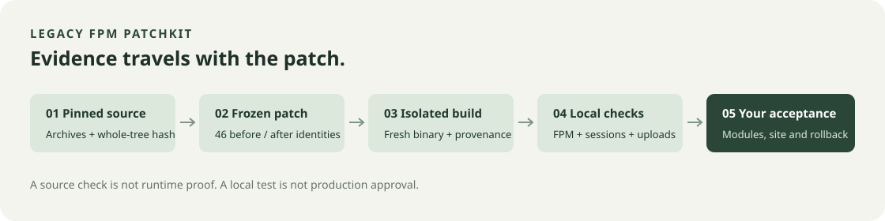

# Legacy FPM Patchkit

**An inspectable, pinned-source security backport kit for PHP 7.0 FPM operators.**

Reconstruct the source. Inspect the patch. Build in isolation. Verify your own environment before activation.

[한국어](README.ko.md) · [Getting started](docs/GETTING_STARTED.md) · [Support](SUPPORT.md) · [Verification](docs/VERIFICATION.md) · [Documentation](docs/README.md)

[](https://github.com/Two-Weeks-Team/legacy-fpm-patchkit/actions/workflows/checks.yml)

Source release archives include SHA-256 checksums and GitHub provenance attestations. See [release verification](docs/RELEASE_NOTES.md).

> **Source release for a legacy runtime.** This independent project backports selected security changes to Ubuntu's `7.0.33-0ubuntu0.16.04.16` source baseline. It does not restore upstream support, repair every PHP vulnerability, or certify arbitrary extensions and applications. Prefer a supported PHP release. Read the [exact support boundary](SUPPORT.md) before building or changing a service.

<!-- SECURITY_COVERAGE_START -->
## Official security coverage — 2026-11-14

All **66 published official PHP repository advisories** were compared with the pinned source. See the [complete coverage matrix](docs/SECURITY_COVERAGE.md) for scope, per-item evidence and planned work.

| Official catalog status | Count |
|---|---|
| Resolved · implementation present | 2 |
| Not applicable · reported mechanism absent | 13 |
| Unresolved · implementation planned | 51 |

**31 existing vendor-patched CVEs are accounted for separately.** Resolved means protection code is present, not that every exploit was validated. Unimplemented protection is not a pass. The matrix exhausts the current official GitHub catalog and named vendor patches, not every historical PHP/dependency CVE.
<!-- SECURITY_COVERAGE_END -->

## What was wrong, and what is addressed

**The purpose is to address two disclosed PHP engine vulnerability classes in a pinned PHP 7.0 FPM source tree, including the request/session boundaries needed by that port.** The source changes are included and their identities verified; fresh tests establish the specific runtime behaviors listed below. They are not a demonstration that every exploit of either CVE is blocked on PHP 7.0.

| Disclosed problem | Why it matters | What this backport changes |
|---|---|---|
| **[CVE-2026-109618 — OOM state corruption](https://github.com/php/php-src/security/advisories/GHSA-w8hw-w9fx-j79w)** | An abrupt out-of-memory bailout can leave partially updated structures that shutdown later consumes. Upstream reports remote code execution; the demonstrated pre-application path is on mod_php. Its FPM analysis identifies a post-startup risk but does not demonstrate a complete FPM exploit. | Ports delayed soft-OOM handling to VM safe points, allocation-failure propagation and consistent cleanup; an unrecoverable hard OOM terminates the process. The goal is to avoid continuing cleanup with half-updated engine state. |
| **[CVE-2026-109619 — stale request state](https://github.com/php/php-src/security/advisories/GHSA-6wmf-4rv5-p3rp)** | A persistent worker can retain pointers into a completed request, then use freed memory before the next request is fully initialized. Upstream reports memory disclosure/RCE and demonstrates the session-lifecycle path on FPM as well as mod_php. | Resets executor/error/superglobal state at request boundaries, initializes relevant state before early input handling, and isolates early upload-progress session decoding from normal user-class handling. |

These are **independent PHP 7.0 adaptations**, not official PHP 7.0 fixes. Upstream's supported-branch advisories establish the original issues; their affected-version tables do not establish this port's completeness or make every newer-version example applicable to PHP 7.0. [Source mapping and provenance](docs/PATCH_SCOPE.md) explain the implementation.

## Additional failure paths addressed by the port

The port also anticipates related failure modes in PHP 7.0. These are concrete protective changes, **not claims to fix unknown future CVEs**.

| Failure mode | Protective change and expected effect | Evidence level |
|---|---|---|
| Request parsing uses one session codec, then application code switches to another | Reject different-codec runtime changes even if upload progress is currently Off; both phases retain one format. Initial codec selection and same-codec assignment remain supported. | **Observed:** the stock copy allows a switch, the candidate blocks it, and both start a normal session. [Paired result](evidence/xenial-policy-difference-20261114.json). This is a deliberate compatibility change. |
| Upload-progress handling reaches session objects before ordinary request initialization | Use a scoped early-decoding mode that avoids resolving user classes at this stage, restore that mode, then let ordinary initialization decode normally. This targets premature callback/state access. | **Implemented in source.** Fresh public tests cover ordinary plain-data uploads/sessions, not object-callback security cases or every extension. |
| A pending OOM is followed by more result processing or a new call | Add checks at VM/call boundaries and allocation-failure paths so a pending failure is handled before later code consumes an invalid result. Request teardown clears temporary OOM/early-mode state. | **Implemented in source.** Fresh public tests do not inject OOM or establish all failure-path outcomes. |

## What has actually been verified

| Check | Completed result | What it establishes |
|---|---|---|
| Official-source reconstruction | 84 vendor patches, 46 changed-file pre/post hashes and both full normalized source digests match | The published cumulative patch reconstructs the intended source; this is not exploit validation |
| Native FPM on Ubuntu 16.04.7 and 22.04 x86-64 | **36 named benign checks per environment**: three session codecs × progress On/Off | Plain session persistence, codec policy, small upload content/cleanup and same-worker continuity |
| Stock/candidate comparison on Xenial | **Policy difference observed** with hashed binaries | A real intentional behavior change, not two tests that both pass unchanged |
| Toolkit and public download | **57 unit tests** on current source; v0.1.0 download passed 45 tests, checksum and GitHub provenance verification | Tooling regressions and source-package integrity, not a site's deployment readiness |

[Exact records and failure history](docs/VERIFICATION.md) are published. Historical msgpack failures and a candidate-only PHPT failure remain documented. This release does not fix third-party modules, prevent scraping/DDoS, repair an existing compromise, or certify application compatibility. Its core claim is **the two targeted engine backports plus the stated PHP 7.0 protective adaptations, with evidence separated from expected effects**. Read [behavior changes](docs/BEHAVIOR_CHANGES.md) and [support limits](SUPPORT.md) before use.



## Why this exists

Some applications cannot immediately leave PHP 7.0. A patch without its build inputs is difficult to audit; a binary without its environment is difficult to trust. This kit publishes the source identity, cumulative backport, repeatable preparation steps and small local regression tools together.

- **Pinned inputs:** official source archive URLs and SHA-256 digests, all 84 Ubuntu vendor patches, then the build007 cumulative backport.
- **Drift detection:** 46 changed files have before/after digests; normalized whole-source digests detect changes outside the patch.
- **No hidden build cache:** standalone Linux profiles and build records replace private paths and external configuration files.
- **Native checks:** real CLI/FPM, plain-data session persistence, rejected runtime serializer changes, small multipart uploads and same-worker continuity.
- **Local inspection and recovery practice:** read ELF/hash metadata without executing a candidate; exercise backup/replace/restore in a new synthetic directory.
- **Honest evidence:** source checks, benign native tests, historical security experiments and application acceptance are separate claims.

## Start with verification

Use Python **3.10+**, Git and `patch` on your control machine. Source preparation works on macOS and Linux; compilation needs a separate Linux environment. No Python package installation is required.

```sh
git clone https://github.com/Two-Weeks-Team/legacy-fpm-patchkit.git
cd legacy-fpm-patchkit
python3 -m patchkit verify
python3 -m unittest discover -v
python3 -m patchkit fetch
python3 -m patchkit prepare
```

`fetch` downloads three public Ubuntu source files over HTTPS and checks pinned digests. `prepare` works offline and requires a new output directory. Neither command compiles, installs, contacts your server or changes a running process.

Next, follow the [getting-started guide](docs/GETTING_STARTED.md) to build in isolation and run the native checks. A successful source check is **not** a deployment approval.

## What is patched

The backport derives from PHP's upstream state-corruption/OOM work for **CVE-2026-109618** and **CVE-2026-109619**, with PHP 7.0 adaptations and later correctness fixes. It also deliberately rejects changing to a *different* session serialization handler at runtime; selecting a handler in initial configuration and assigning the same handler remain supported.

The patch includes allocator/failure propagation, request-state lifetime, session handling and related call-site changes. It is a substantial engine backport, not a one-line configuration fix. See [patch scope and provenance](docs/PATCH_SCOPE.md), [behavior changes](docs/BEHAVIOR_CHANGES.md) and [known limits](SUPPORT.md).

## Build and check

The `portable` profile is for isolated native regression on a contemporary Linux build host. It is **not** a drop-in Ubuntu 16.04 binary. The `xenial-amd64` profile requires Ubuntu 16.04 x86-64 and the documented development libraries; it still requires your own module/application checks.

```sh
# In the documented isolated Linux environment, after source preparation:
bash scripts/build.sh .work/source .work/build portable
python3 scripts/native-check.py \
  --fpm .work/build/php-fpm --cli .work/build/php \
  --output .work/native-result.json
python3 -m patchkit inspect \
  --binary .work/build/php-fpm --build-record .work/build/build.json
python3 -m patchkit rehearse \
  --candidate .work/build/php-fpm --output .work/recovery-drill
```

Build scripts never run `make install`, replace a system file, reload a service or control a container. The native checker launches and stops **its own local test FPM** on a private Unix socket. See [installation and rollback](docs/INSTALLATION.md) for the operator-controlled service transition.

## Repository map

```text
patches/          Frozen cumulative build007 patch
provenance/       Official archive pins and per-file source identities
patchkit/         Standard-library source, binary inspection and rehearsal CLI
scripts/          Isolated Linux build and benign native checks
tests/            Integrity, unsafe-input, transport and recovery regressions
evidence/         Sanitized, versioned public-kit verification results
licenses/         Original PHP, Zend, FPM and other applicable notices
docs/             User guides, architecture, behavior and verification limits
```

## Contribute and report

Read [CONTRIBUTING.md](CONTRIBUTING.md) for reproduction requirements and [SECURITY.md](SECURITY.md) for private vulnerability reporting. Do not post credentials, session cookies, server configurations, raw access logs or personal data in issues.

Development and operational records remain private. This repository has an independent, reviewed history containing deliberately selected public artifacts. It includes no deployment approvals or site-specific controller.

## License and attribution

New kit tooling and documentation are [MIT](LICENSE), **except imported/derived material**. The PHP-derived patch retains its applicable upstream licenses; it is not relicensed as MIT. Read [THIRD_PARTY_NOTICES.md](THIRD_PARTY_NOTICES.md) and the originals in `licenses/`.

This product includes PHP software, freely available from <http://www.php.net/software/>.

This product includes the Zend Engine, freely available at <http://www.zend.com>.

PHP and vendor names identify compatibility and provenance; this is not an official PHP, Zend, Canonical or Freexian product.
