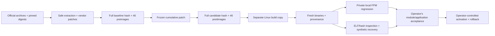

# Architecture and trust boundaries

`patchkit.sources` owns integrity and new-directory preparation. `patchkit.fcgi` owns bounded Unix FastCGI framing; it has no external server target. `patchkit.inspection` reads metadata without binary execution. `patchkit.rehearsal` exercises only synthetic files. Build/native scripts explicitly execute verified source/trusted test binaries in isolation.

Source controls do not establish binary trust; binary execution does not establish production service acceptance. No successful tool result is promoted to `DEPLOYMENT_APPROVED`. Reports describe their own layer.

The public repository is an independently curated snapshot, not a copy of operational history. GitHub CI uses minimal permissions and has no site credentials. There is no automatic update, remote shell, approval-record writer or production service adapter.
